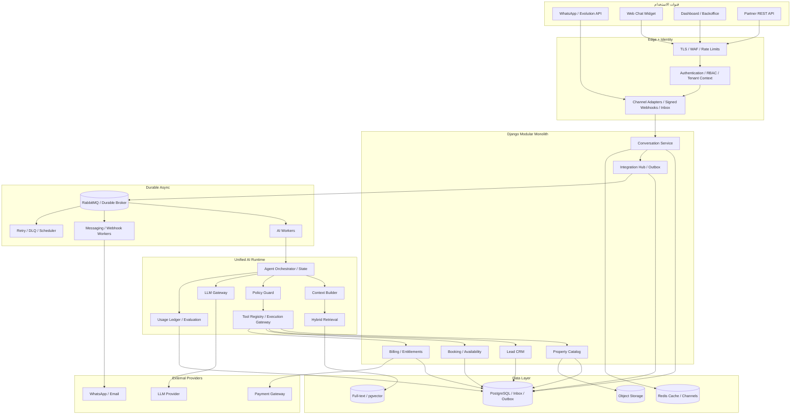

# Inify Estate AI — تعليمات التنفيذ للوكيل البرمجي
**الإصدار:** 1.0  
**نوع المستند:** Implementation Specification + Agent Execution Prompt  
**المستودع المستهدف:** `https://github.com/Mrsos07/inify`  
**الهدف:** ترقية المنصة الحالية إلى معمارية V2 الإنتاجية دون إعادة كتابة المشروع أو فقدان التوافق مع وظائفه وبياناته.

> **تعليمات أساسية للوكيل:** هذه وثيقة تكليف بالتنفيذ، لا مجرد توصيات. ابدأ بفحص الكود الفعلي وتحديد ما هو موجود بالفعل، ثم نفّذ الفجوات على مراحل مع اختبارات وإثباتات. لا تدّعِ اكتمال أي مهمة دون شيفرة واختبارات ونتيجة تشغيل. لا تنشر أو تعدّل الإنتاج أو تدوّر أسراراً فعلية دون تصريح من مالك النظام.

---

## 0. رسالة بدء التنفيذ — انسخها للوكيل البرمجي

أنت **Principal Software Architect + Senior Django/AI Engineer + AppSec Engineer + SDET**. مهمتك تطوير مشروع Inify Estate AI الموجود في المستودع، وليس إنشاء مشروع بديل. اقرأ هذا المستند كاملاً، وافحص المستودع وفرعه الحالي، وأنشئ `docs/architecture/current-state-audit.md` وجدول فجوات يربط كل متطلب بالملفات المتأثرة. اعمل وفق المراحل P0 إلى P5. في كل مرحلة: (1) خطة قصيرة، (2) تنفيذ فعلي، (3) Migration آمنة عند الحاجة، (4) اختبارات تلقائية، (5) توثيق، (6) تقرير بنتائج دقيقة وأدلة، (7) انتظر موافقة المالك قبل الانتقال إلى مرحلة جديدة أو تنفيذ تغيير غير قابل للتراجع. لا تستبدل Django بـMicroservices؛ استخدم **Modular Monolith + Unified Agent Runtime + Independent Workers**. لا تحذف وظائف أو واجهات قائمة، ولا تضع مفاتيح حقيقية في المستودع. إذا وجدت تعارضاً بين هذه الوثيقة والكود، سجّله وطبّق الحل الأكثر أماناً مع الحفاظ على التوافق. أوقف التنفيذ عند نقص متطلب مؤثر واطلب قراراً واضحاً.

## 1. مبادئ هندسية غير قابلة للتفاوض

1. **الحفاظ على المشروع:** إعادة هيكلة تدريجية مع المحافظة على عقارات، عملاء، حجوزات، اشتراكات، قنوات واتساب، لوحة التحكم وواجهات التكامل.
2. **المصدر الوحيد للحقيقة:** PostgreSQL لبيانات الأعمال؛ Redis للتخزين المؤقت وChannels؛ Broker متين للمهام؛ لا تعتمد على الذاكرة المحلية لضمان التسليم.
3. **عزل المستأجرين:** كل عملية قراءة أو كتابة تتبع `tenant_id` الموثوق من هوية المستخدم أو قناة موثقة، وليس قيمة يرسلها العميل دون تحقق.
4. **Zero Trust للـLLM:** النموذج يقترح أفعالاً ولا يمنح صلاحيات. جميع الأدوات تتحقق من السياسات والملكية والمدخلات.
5. **Backward compatibility:** نسخ API، ومهاجرات Additive أولاً، وFeature Flags عند تغيير السلوك.
6. **Idempotency + Auditability:** العمليات المؤثرة والدفع والرسائل والحجوزات لا تتكرر عند إعادة المحاولة.
7. **Observability by design:** طلب، مستأجر، محادثة، عملية، استخدام وتكلفة مع إخفاء البيانات الشخصية والأسرار.
8. **لا نجاح وهمياً:** لا تعتبر Docker Build أو استجابة 200 دليلاً على نجاح الأعمال؛ اختبر رحلة المستخدم من البداية للنهاية.

## 2. فحص الواقع الحالي قبل أي تعديل (Mandatory Audit)

افحص `apps/`, إعدادات Django، ملفات `requirements*`، Docker، Render، README، المهاجرات، الاختبارات، ومداخل API. حدد مواضع `PublicChatView`, `get_property_appointments`, `check_admin_access`, `NewraAIService`, `OpenAIService`, StreamPay webhooks, Evolution API webhooks, `CHANNEL_LAYERS`, وملفات البيئة. قد تكون الأسماء تغيّرت؛ ابحث عن الوظيفة بدلاً من افتراض المسار.

أنشئ جدولاً: `Requirement ID | Current implementation | File:line | Gap | Risk | Proposed change | Test | Status`. لا تُكرر مكوّناً يعمل فعلاً. احصر الـEndpoints العامة والداخلية، ومالك كل Route، وطريقة التوثيق، ونوع بياناته. احصر الجداول وعلاقاتها والمهاجرات المتأخرة والمهام الخلفية ومزودي AI.

**مخرجات إلزامية:** `docs/architecture/current-state-audit.md`، `docs/architecture/adr/`، و`docs/implementation/traceability-matrix.md`.

---

## P0 — Security & Tenant Isolation (أولوية مانعة للإطلاق)

### SEC-01 إدارة الأسرار وسلسلة البناء
- امنع إدراج `.env*` الإنتاجية والمفاتيح والاعتمادات في Git وDocker context؛ أبقِ `*.example` بقيم وهمية فقط.
- نفّذ Secret Scanning في CI (مثل Gitleaks) ومنع الدمج عند اكتشاف أسرار.
- استخدم متغيرات البيئة أو Secrets Manager، مع فصل Development/Staging/Production.
- جهّز **خطة** تدوير الأسرار المسربة وتنظيف Git history، وبيّن تأثير Force Push على الفريق؛ لا تنفذ على الريموت أو مفاتيح الإنتاج دون إذن.
- اختبر أن صورة Docker النهائية لا تحتوي أسراراً أو ملفات إعداد إنتاج حساسة.

### SEC-02 توثيق المستخدمين وRBAC
- اجعل Django Authentication وصلاحيات واضحة للأدوار (`platform_admin`, `tenant_owner`, `tenant_admin`, `agent_operator`, `sales`, `read_only`) مع مراعاة الأدوار الحالية.
- أزل الاعتماد على مفتاح إدارة ثابت كبديل عن الهوية والصلاحية؛ نفّذ انتقالاً آمناً، وMFA للإدارة إن أمكن.
- فرض صلاحية كل Endpoint، وليس واجهة المستخدم فقط؛ منع IDOR/BOLA عبر كل موارد النظام.
- أنشئ Permission Matrix واختبارات Allow/Deny لكل دور.

### SEC-03 عزل المستأجرين والمحادثات
- اجعل Tenant Context مشتقاً من جلسة موثوقة أو API Key موثق أو WhatsApp Instance مربوط بالمستأجر.
- جميع استعلامات `Property`, `Lead`, `Conversation`, `Appointment`, `Agent`, `TeamMember`, `Subscription`, `Webhook`, `APIKey`, `Usage` مقيدة بالمستأجر حيث ينطبق.
- للدردشة العامة: إصدار **رمز جلسة عشوائي وموقّع** ومقيد بالمحادثة والوكيل والمستأجر مع صلاحية زمنية؛ لا تسمح باستخدام `conversation_id` وحده كإثبات ملكية.
- امنع الوصول بين الشركات حتى عند معرفة UUID صالح. اختبر تبديل tenant/agent/conversation IDs.
- تأكد من حماية بيانات العملاء في Endpoint المواعيد، ومنع إرجاع الهاتف أو الملاحظات للزوار غير المخولين.

### SEC-04 Webhook Integrity & Replay Protection
- **الدفع:** ارفض Webhook إن لم يكن توقيعه صحيحاً أو سر التحقق غير مهيأ؛ تحقق من raw body وفق مواصفات مزود الدفع، واستخدم event_id فريداً، ولا تفعّل الاشتراك إلا بعد تحقق الحالة والمبلغ والعملة والمرجع من مزود الدفع.
- **واتساب:** تحقّق من التوثيق المتاح في Evolution API/البوابة (توقيع أو سر أو قناة خاصة)، مع فحص مصدر الحدث ومطابقة Instance للمستأجر؛ لا تعتمد على اسم Instance فقط.
- نفّذ replay window، ومخزن أحداث Inbox، وDeduplication بمعرف حدث موثوق.
- لا تسجل جسم Webhook الخام المحتوي على أرقام أو رسائل أو أسرار.

### SEC-05 حماية HTTP وAPI
- أزل `csrf_exempt` من مسارات جلسات المتصفح التي تغيّر الحالة؛ استثنِ فقط Webhooks الموثقة بطريقة مناسبة.
- طبّق CORS allowlist وCSRF Trusted Origins وSecure/HttpOnly/SameSite cookies وHSTS بحسب بيئة النشر.
- لا تمرر API Keys في Query String؛ استخدم Header وHash للمفاتيح المخزنة (مع آلية عرض لمرة واحدة وانتقال للمفاتيح القديمة).
- نفّذ Rate Limits حسب IP وTenant وAgent وAPI Key، وحدود حجم الطلب وملفات الرفع.
- منع SSRF في Outbound Webhooks: السماح بـHTTPS وفق سياسة، منع loopback/private/link-local/metadata IPs، فحص DNS وRedirects وإعادة التحقق عند الاتصال، Timeouts وEgress Policy.
- راجع الأخطاء لتجنب كشف Stack Trace أو أسرار في API responses.

**معايير قبول P0:** جميع اختبارات cross-tenant سلبية؛ لا يستطيع زائر قراءة موعد عميل؛ رفض الدفع المزور؛ رفض Webhook واتساب غير الموثق؛ عدم وجود أسرار داخل Git/Images الجديدة؛ CI Security Checks ناجحة.

---

## P1 — Modular Monolith + Durable Async Infrastructure

### ARC-01 تنظيم الوحدات
احتفظ بـDjango/DRF. افصل المسؤوليات من Views الضخمة إلى خدمات نطاقات واضحة، مع الاحتفاظ بالمسارات الخارجية الحالية قدر الإمكان:
- `identity_tenants` — حسابات، عضويات، أدوار، سياسات.
- `properties` — العقارات، التوافر، الوسائط والبحث.
- `crm` — العملاء، التأهيل، الحالات والتعيين.
- `appointments` — مواعيد المعاينات، التأكيد والإلغاء.
- `conversations` — الرسائل والجلسات وقنوات التفاعل.
- `agents` — إعداد الوكلاء وسياساتهم وأدواتهم.
- `billing` — الاشتراكات والمدفوعات والاستحقاقات.
- `integrations` — Webhooks وPartner APIs وWhatsApp.
- `audit_usage` — أحداث التدقيق والاستهلاك.
هذه **حدود منطقية مقترحة**؛ لا تُعِد تسمية تطبيقات موجودة أو تنقل موديلات بطريقة تكسر المهاجرات دون خطة معتمدة.

### ARC-02 Broker + Worker Pools
- استخدم Celery مع RabbitMQ durable queues **أو** بديلاً موثقاً يضمن المتانة وإعادة المحاولة؛ Redis يبقى Cache/Channels، ويمكن استخدامه Broker فقط بقرار موثق يوضح ضمانات الاسترداد.
- افصل Queues: `ai`, `messaging`, `notifications`, `integrations`, `maintenance`.
- Workers مستقلة قابلة للتوسعة مع timeouts، concurrency limits، backoff+jitter، max retries، وDLQ/failed-job registry وإعادة معالجة يدوية.
- لا تستخدم Threads داخل Web Worker لمعالجة رسائل أو أحداث أعمال مهمة.
- لا تجعل Webhook ينتظر استدعاء LLM؛ أرجع ACK بعد التحقق والتخزين المتين فقط.

### ARC-03 Inbox/Outbox + Exactly-once Business Effects
- Inbox: unique `(provider, external_event_id, tenant_id)` حيث تنطبق هوية الحدث؛ حالات `received/processing/completed/failed`.
- Outbox: حفظ الحدث المطلوب إرساله في **نفس معاملة DB** التي تحفظ أثر الأعمال؛ عامل مستقل ينشره مع retries.
- استهدف **at-least-once delivery + idempotent business effects**، ولا تدّعِ exactly-once delivery على الشبكة.
- امنع تكرار إنشاء Lead/Appointment أو تحصيل الدفع عند إعادة إرسال الحدث.
- سجّل أسباب الفشل وعدد المحاولات وتوقيت المحاولة التالية.

### ARC-04 Realtime + Redis
- استبدل InMemoryChannelLayer في الإنتاج بـRedis-backed Channels Layer مع ASGI deployment وRedis مركزي.
- تحقق من عمل WebSockets عبر نسختين من Web/API وليس عملية واحدة فقط.
- استخدم Cache Keys ذات Tenant Namespace وTTL، ولا تعتمد على Cache Lock وحده لحماية حجوزات DB.

**معايير قبول P1:** إعادة تشغيل Worker أثناء المهمة لا يفقد الحدث؛ إعادة تسليم Webhook لا تكرر أثر الأعمال؛ وصول WebSocket بين نسختين؛ جميع المهاجرات قابلة للتطبيق على DB نظيفة ونسخة بيانات Staging.

---

## P2 — Unified Agent Runtime & AI Governance

### AI-01 توحيد نقطة تنفيذ الوكيل
- أنشئ واجهة خدمة واحدة `AgentRuntime.handle(message, context)` تستخدمها Web Chat وWhatsApp وPartner API.
- ضع Channel Adapters لتوحيد `{tenant, agent, channel, external_message_id, conversation, sender, content, attachments, metadata}`.
- عزل مزود LLM خلف `LLMGateway` يدعم OpenAI حالياً وقابلية إضافة مزود آخر لاحقاً دون تكرار Business Logic.
- ترحيل تدريجي لمسارات `NewraAIService` و`OpenAIService` وأي استدعاءات مباشرة؛ استخدم Feature Flag وShadow Tests عند الحاجة.

### AI-02 Orchestrator & Conversation State
- دورة واضحة: `ingest -> authorize -> load state -> retrieve -> decide -> validate tool -> execute -> respond -> persist -> meter`.
- حدد حدوداً للخطوات والأدوات والوقت والتوكنز؛ مثال مبدئي قابل للضبط: 5 tool calls/turn و30–60 ثانية لعمليات AI غير المتزامنة.
- امنع حلقات الاستدعاء غير المنتهية عبر `max_iterations`, `deadline`, `tool_call_fingerprint` لكشف التكرار، وfallback/human handoff.
- الذاكرة قصيرة المدى مرتبطة بالمحادثة والمستأجر؛ تلخيص سياق المحادثات الطويلة دون تسريب بيانات شركات أخرى.
- اجعل Prompt Templates قابلة للإصدار (versioned) واختبار التغييرات.

### AI-03 Policy Guard & Tool Registry
- سجل أدوات بعقود Typed Inputs/Outputs (Pydantic أو DRF Serializers) وأسماء وإصدارات وصلاحيات.
- أدوات أساسية: `search_properties`, `get_property_details`, `create_or_update_lead`, `get_availability`, `book_viewing`, `cancel_or_reschedule_viewing`, `handoff_to_human`.
- تحقق من Tenant Scope وصلاحية الدور وملكية الموارد **داخل كل Tool Handler**؛ لا تثق بمدخلات LLM.
- أدوات القراءة بلا تأكيد؛ أدوات الكتابة المؤثرة تتطلب تأكيداً صريحاً عند الاقتضاء، مع رموز تأكيد قصيرة العمر وIdempotency Key.
- امنع تسرب System Prompt أو مفاتيح الأدوات في Public Agent Config.
- طبّق Prompt Injection Defense: فصل التعليمات عن محتوى المستخدم/العقار، منع استخدام نصوص الاسترجاع كتعليمات، validation للمخرجات، allowlisted tools، وعدم تمكين LLM من تنفيذ كود أو HTTP عشوائي.

### AI-04 Hybrid Property Retrieval
- نفّذ Structured Filters أولاً (المدينة، الحي، السعر، النوع، المساحة، الحالة، التوافر، Tenant).
- استخدم PostgreSQL full-text + pgvector عند الحاجة، مع Embeddings للحقول المناسبة وإعادة فهرسة عند التعديل.
- Hybrid Ranking: نتائج فلاتر + نصية + دلالية، ثم rerank؛ لا تسمح بظهور عقارات خارج المستأجر أو غير متاحة.
- أرجع Property IDs وأسباب الملاءمة مع منع اختلاق الأسعار والمواصفات.
- أضف fallback إلى Structured Search إذا تعطل Vector Index.

### AI-05 Metering, Evaluation, Human Handoff
- سجل كل LLM call: `tenant_id`, `agent_id`, `conversation_id`, `provider`, `model`, `prompt_version`, `input_tokens`, `output_tokens`, `cost_estimate`, `latency`, `status`, `trace_id` دون تخزين أسرار أو PII في Telemetry.
- احسب الاستهلاك عبر كل دورات Tool Calling بما فيها الاستدعاءات المتكررة، مع دعم قواعد تسعير إصدارات النماذج.
- مجموعة تقييم واقعية: أسئلة عقارات، أسعار، تأهيل Lead، حجز، طلبات غير متاحة، Prompt Injection، أخطاء مزود AI، والتحويل إلى موظف.
- حدد قياسات: task completion, grounded answer rate, tool error rate, handoff rate, p50/p95 latency, token cost per resolved conversation.
- دعم Escalation إلى موظف مع سياق ملخص وآمن.

**معايير قبول P2:** نفس الطلب عبر قناتين يمر بالمحرك نفسه؛ لا يمكن للنموذج تنفيذ أداة خارج الصلاحيات؛ لا حلقات غير منتهية؛ لا إجابات تختلق بيانات عقار في اختبارات التقييم؛ كل مكالمة LLM محسوبة.

---

## P3 — Domain Integrity & SaaS Billing

### DOM-01 الحجوزات
- تحقق من نطاق Tenant والعقار والتوافر والدوام والمناطق الزمنية (خزن UTC واعرض Asia/Riyadh عند الحاجة).
- منع Double Booking بقيود DB ومعاملات ذرية (`transaction.atomic`, locks أو exclusion constraint عند فترات متداخلة)؛ لا تكتفِ بـ`exists()` ثم `create()`.
- حالات الحجز: `pending/confirmed/cancelled/completed/no_show` مع سجل انتقالات واضح.
- اختبارات تزامن فعلية: طلبان للحجز نفسه يؤديان إلى حجز واحد فقط.

### DOM-02 CRM & Leads
- تعريف حالات Lead ومصدره وقواعد دمج المكرر ضمن Tenant.
- ربط المحادثة بالعميل والعقار والموعد والموظف المسؤول، مع Audit Trail.
- تأهيل العميل بناءً على معلومات صريحة؛ لا تخزن استنتاجات حساسة دون حاجة.
- دعم البحث والفلاتر والتصدير وفق RBAC وسجلات تدقيق.

### DOM-03 Billing & Entitlements
- تحقق من حالة الدفع الفعلية من المزود عند الحاجة قبل تفعيل الاشتراك؛ منع تكرار تطبيق Webhook.
- عرّف Entitlements صريحة للباقات: عدد الوكلاء، أعضاء الفريق، المحادثات، حدود AI، القنوات والتكاملات.
- نفّذ Usage Quotas ومراقبة التكلفة والتحذير قبل تجاوز الحد، وسياسة graceful degradation.
- افصل السجلات المالية عن `TokenUsage`، واختبر الترقية والتجديد والإلغاء والاسترجاع وانتهاء الاشتراك.
- لا تغيّر الأسعار أو شروط العملاء دون موافقة المالك.

**معايير قبول P3:** اختبار حجز متزامن ناجح؛ لا عمليات دفع مكررة؛ حدود الباقات تعمل من Backend؛ دورة الاشتراك كاملة مغطاة بالاختبارات.

---

## P4 — API, Integrations, Reliability & Operations

### INT-01 Partner API
- OpenAPI 3.0 موثق، API Versioning، Pagination، Filtering، Rate Limits، وIdempotency للـPOST المؤثر.
- مفاتيح API قابلة للإلغاء والتدوير ومحددة النطاق (`scopes`) والمستأجر.
- Webhook Subscriptions: توقيع HMAC مع Timestamp وEvent ID، Retry وDLQ، وإدارة Delivery Logs.

### OPS-01 Observability
- Structured JSON Logs، Metrics وTraces باستخدام OpenTelemetry أو مكافئ؛ `request_id/trace_id/tenant_id/agent_id` مع Redaction.
- لوحات: أخطاء HTTP، queue lag، فشل Webhooks، latency للـAI، تكلفة Tenant، معدلات الحجز، استهلاك الباقات.
- Alerts على فشل الدفع، تراكم DLQ، تأخر الرسائل، فشل مزود AI، أخطاء DB، وارتفاع تكلفة AI.
- Audit Log غير قابل للتعديل بسهولة للأحداث الإدارية والحساسة، مع سياسة احتفاظ وحذف.

### OPS-02 CI/CD & Infrastructure
- Docker Multi-stage minimal images، non-root user، Health/Readiness Checks.
- Staging يشابه الإنتاج؛ Environment-specific settings، migrations آمنة، Rollback/roll-forward plan.
- CI: format/lint, type checks تدريجياً، unit/integration/security tests، dependency scan، secret scan، image scan، build.
- اختبارات تحميل على سيناريوهات متفق عليها؛ لا تخترع ادعاءات throughput أو SLA قبل القياس.
- نسخ احتياطي PostgreSQL وObject Storage، تجربة Restore دورية، وتحديد RPO/RTO بالاتفاق مع المالك.
- Data Retention/Deletion/Export وسياسة خصوصية وامتثال بحسب متطلبات الجهة والتشريعات السعودية ذات الصلة؛ لا تدّعِ شهادة امتثال دون تدقيق.

**معايير قبول P4:** Pipeline أخضر؛ نشر Staging قابل لإعادة الإنتاج؛ تجربة Restore موثقة؛ مراقبة end-to-end؛ OpenAPI محدث؛ اختبارات تحميل مع تقرير فعلي.

---

## P5 — Product Completion & Handover

- رحلة E2E كاملة: إنشاء Tenant → إعداد وكيل → إضافة عقارات → ربط واتساب/Widget → استفسار → ترشيح عقار → إنشاء Lead → حجز → إشعار → متابعة → تقرير استهلاك.
- واجهة إدارة مناسبة للأدوار، وحالات خطأ واضحة، وEmpty States، وOnboarding عملي.
- وثائق تشغيل للمطور وللمشغل: `README`, `ARCHITECTURE`, `DEPLOYMENT`, `RUNBOOK`, `API`, `SECURITY`, `BACKUP_RESTORE`, `TROUBLESHOOTING`.
- قائمة اعتماد للإطلاق وتقرير مقارنة Before/After مع روابط PRs ونتائج الاختبارات وقياسات الأداء الفعلية.
- لا تعلن `production-ready` إلا بعد اجتياز المعايير المتفق عليها وموافقة المالك.

---

## 3. المعمارية المستهدفة (Mermaid)



### مخطط النشر
- **Web/API Replicas:** Django ASGI/DRF خلف Reverse Proxy مع TLS.
- **Worker Pools:** AI منفصل عن Messaging/Notifications/Integrations.
- **Stateful Services:** PostgreSQL، Redis، Durable Broker، Object Storage، Full-text/Vector Search.
- **Control Plane:** CI/CD، Secrets، Logs/Metrics/Traces، Backup/Restore.
- يمكن بدء النشر بعدد محدود من النسخ ثم التوسع عند ظهور قياسات فعلية؛ لا تفترض الحاجة إلى Kubernetes.

---

## 4. نموذج أحداث وعقود أولية

**Normalized Incoming Message (مثال تصميمي):**
```json
{
  "tenant_id": "resolved-server-side",
  "agent_id": "verified-agent-id",
  "channel": "whatsapp",
  "external_event_id": "provider-event-id",
  "conversation_id": "server-resolved",
  "sender_id": "channel-scoped-id",
  "text": "أبحث عن شقة في الرياض",
  "received_at": "2026-11-03T00:00:00Z",
  "trace_id": "generated-trace-id"
}
```
**ملاحظة:** `tenant_id` و`conversation_id` لا يُوثق بهما إذا جاءا من العميل؛ يُعاد حلهما والتحقق منهما من الخادم.

**أمثلة Domain Events:** `message.received`, `lead.created`, `appointment.booked`, `appointment.cancelled`, `subscription.activated`, `agent.handoff_requested`. لكل حدث `event_id`, `tenant_id`, `schema_version`, `occurred_at`, `correlation_id`, `payload` محدد وخاضع لسياسات خصوصية.

---

## 5. خطة التنفيذ والإبلاغ للمالك

| المرحلة | ترتيب التنفيذ | التحقق المطلوب | نقطة الموافقة |
|---|---|---|---|
| Audit | أولاً | Inventory + Traceability + ADRs | اعتماد خطة التنفيذ |
| P0 | ثانياً | Security Tests + Secrets/Access Review | موافقة قبل تغييرات الأسرار/الريموت |
| P1 | ثالثاً | Durable Jobs + Multi-Replica + DB Migrations | اعتماد البنية التحتية |
| P2 | رابعاً | Agent Evals + Tool Guards + Cost Ledger | اعتماد سياسة الأدوات والنماذج |
| P3 | خامساً | Booking Concurrency + Billing E2E | اعتماد قواعد الأعمال |
| P4 | سادساً | CI/CD + Load/Restore Reports | اعتماد التشغيل |
| P5 | أخيراً | E2E Demo + Handover + Release Checklist | قبول نهائي |

**صيغة تقرير كل مرحلة:**
```text
Phase:
Status: completed / partial / blocked
Implemented:
Changed files / PRs:
Database migrations:
Tests executed (command + pass/fail):
Security checks:
Performance evidence:
Compatibility risks:
Manual verification needed:
Pending decisions:
Next phase:
```

## 6. Definition of Done (معايير الإغلاق النهائي)

- [ ] جميع المتطلبات مرتبطة بملفات وCommits واختبارات.
- [ ] لا توجد أسرار فعلية في الكود أو صور البناء الجديدة.
- [ ] منع الوصول بين المستأجرين والوكالات والمحادثات مثبت باختبارات.
- [ ] توقيعات الدفع وWebhooks والتحقق من Idempotency تعمل.
- [ ] جميع مسارات AI تستخدم Runtime موحداً.
- [ ] Tools تتحقق من الصلاحيات والتأكيد ولا تنفذ إجراءات غير مخولة.
- [ ] مهام الخلفية تتحمل إعادة المحاولة وتعطل Workers دون تكرار أثر الأعمال.
- [ ] الحجوزات آمنة عند التزامن.
- [ ] سجل الاستهلاك يشمل جميع استدعاءات النماذج.
- [ ] Redis Channels يعمل عبر أكثر من نسخة.
- [ ] API موثق، وCI/CD والاختبارات والتتبع فعالة.
- [ ] تجربة استعادة بيانات ناجحة ومثبتة.
- [ ] Demo end-to-end يعمل على Staging.
- [ ] لا توجد تغييرات كاسرة غير معتمدة أو حذف غير مقصود لميزات قائمة.

## 7. تعليمات منع الانحراف للوكيل

- لا تستبدل المشروع بمثال أو Skeleton.
- لا تعِد بإنجاز جميع المراحل في Commit واحد.
- لا تحذف migrations أو تعيد توليدها عشوائياً.
- لا تستخدم `--fake` أو إسقاط جداول لتجاوز مشكلة Migration.
- لا تضع Mock Services في الإنتاج لتبدو الاختبارات ناجحة.
- لا تتجاوز صلاحيات النظام من أجل إتمام تدفق AI.
- لا تنشئ Webhook أو endpoint غير موثق الصلاحيات.
- لا تنشر تغييرات إلى Production ولا تعدّل DNS أو مزود الدفع دون إذن.
- لا تخفِ فشل اختبار؛ سجّل السبب والإصلاح أو العائق.
- عند وجود قرار بين حل سريع وهندسة متينة، قدّم الخيارين مع أثرهما واطلب الموافقة إذا كان مؤثراً.

**الخطوة الأولى المطلوبة الآن:** ابدأ بفحص المستودع وإنتاج Audit + Gap Matrix فقط، ثم اعرض خطة P0 بالملفات والاختبارات المتوقعة للحصول على الموافقة قبل التعديل.
